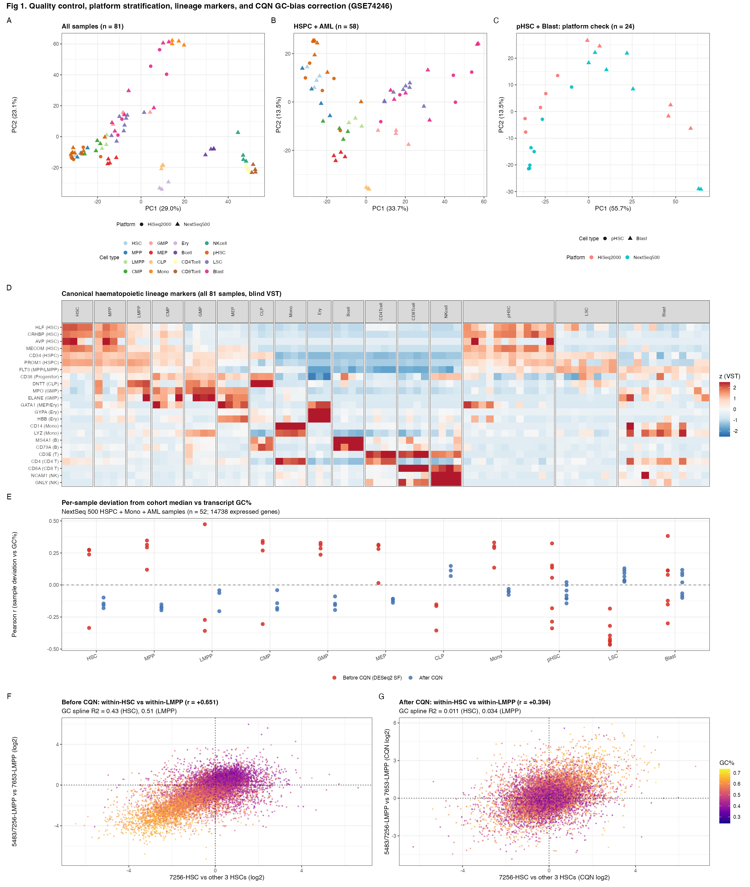
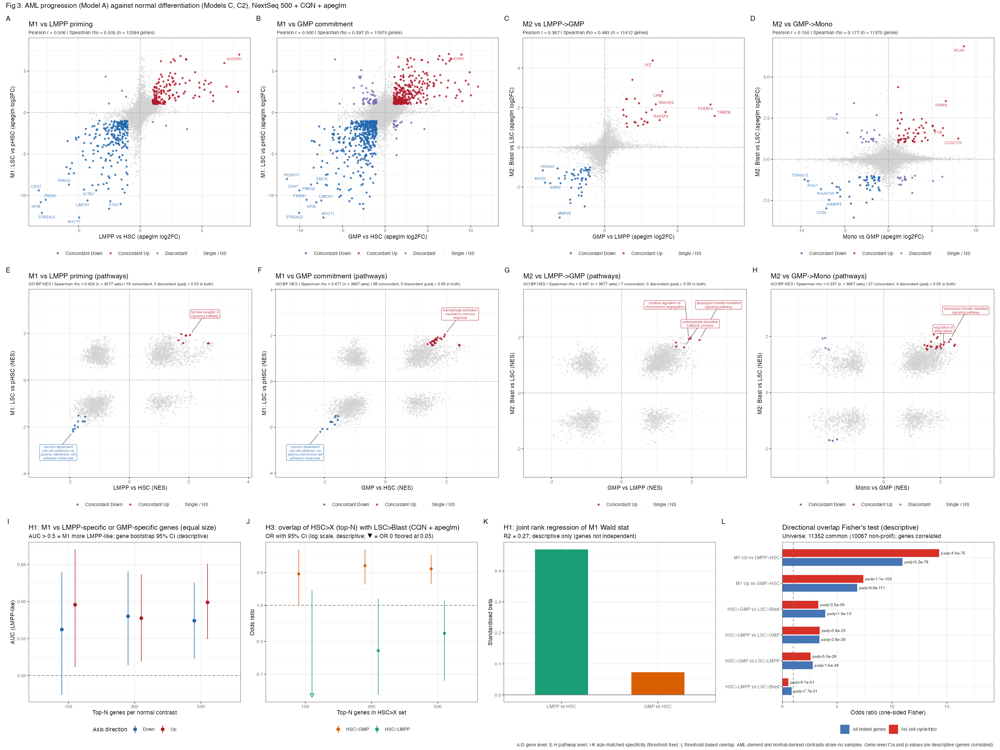
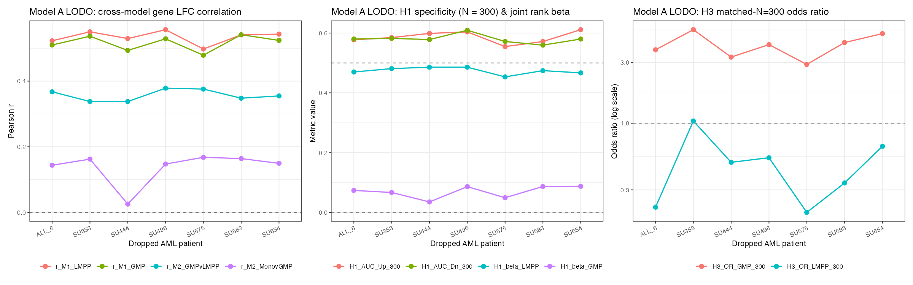

# AML Leukaemic Stem Cell Transcriptomics & CQN-DESeq2 Reanalysis (`GSE74246`)

Reproducible statistical transcriptomics pipeline reanalysing sorted normal human haematopoietic populations and acute myeloid leukaemia (AML) pre-leukaemic HSC (`pHSC`), leukaemic stem cell (`LSC`), and blast (`Blast`) fractions from **GSE74246** (Corces *et al.*, 2016, *Nature Genetics*, PMID `27526324`).

## Scientific Question & Statistical Design

Rather than relying on default size-factor normalisation across heterogeneous low-input RNA-seq libraries, this workflow explicitly diagnoses technical confounding before hypothesis testing:

1. **Platform & GC-content forensics (`scripts/03_qc_and_cqn.R`)**: Separates `HiSeq2000` (`GPL11154`) and `NextSeq500` (`GPL18573`) libraries (`n = 81`) and uncovers a strong within-cell-type transcript GC-content bias axis in NextSeq 500 samples (`GC` natural-spline $R^2 = 0.43$ within HSCs and $0.51$ within LMPPs, cross-lineage $r = +0.651$).
2. **Exact UCSC hg19 CQN offset modelling (`scripts/02_build_gene_gc.py`, `scripts/04_de_integration_lodo.R`)**: Rebuilds per-gene spliced mRNA GC content and length from UCSC `hg19` `refGene`/`refMrna` (resolving legacy 2015 HGNC aliases unambiguously via `org.Hs.eg.db`) and passes geometric-mean-centred Conditional Quantile Normalisation (`CQN`) offsets into `DESeq2` with `apeglm` shrinkage, collapsing the technical GC spline $R^2$ to `0.011` (HSC) and `0.034` (LMPP).
3. **Disjoint-cohort cross-model hypothesis testing**: Fits four NextSeq-only models (`Model A`: 6 paired AML donor trios `~ donor + cell_type`; `Model B`: AML vs healthy HSPC counterparts; `Model C`: 4 paired healthy donors `HSC -> MPP -> GMP -> Mono`; `Model C2`: normal `HSC -> LMPP -> GMP`). Because AML progression contrasts (`M1: LSC vs pHSC`, `M2: Blast vs LSC`) share **zero samples** with normal differentiation contrasts (`Models C, C2`), cross-model gene and GO:BP pathway concordance is free of shared-control noise coupling.
4. **Threshold-free specificity & Leave-One-Donor-Out (LODO) validation**: Controls for unequal statistical power between normal LMPP (`n = 3`, unpaired) and GMP (`n = 4`, paired) contrasts via equal-size top-$N$ (`150`, `300`, `500`) specificity AUCs, joint rank-standardised regression, non-proliferative (cell-cycle/ribosomal-excluded) universe controls, and full 6-patient LODO refitting (`SU353`–`SU654`).

## Key Quantitative Findings

### 1. Elimination of Technical GC Bias via CQN (`results/summary/technical_axis_gc_r2.tsv`)

| Within-Cell-Type Technical Axis | Pearson $r$ vs GC% | Spline $R^2$ (GC%) | Spline $R^2$ (Length) | Spline $R^2$ (GC + Length) |
| :--- | :--- | :--- | :--- | :--- |
| Within-HSC (Before CQN, DESeq2 SF) | `-0.620` | `0.433` | `0.040` | `0.438` |
| Within-LMPP (Before CQN, DESeq2 SF) | `-0.688` | `0.512` | `0.031` | `0.512` |
| Within-HSC (After CQN) | `+0.081` | `0.011` | `0.001` | `0.011` |
| Within-LMPP (After CQN) | `+0.175` | `0.034` | `0.007` | `0.037` |



### 2. Cross-Model AML Progression vs Normal Differentiation (`results/summary/`)

- **H1 (`M1: LSC vs pHSC` aligns predominantly with LMPP priming)**: Across matched top-$N$ gene sets (`N = 150, 300, 500`), LMPP-specific genes track `M1` more strongly than GMP-specific genes in both directions (`AUC = 0.562–0.599`, `specificity_H1_matchedN.tsv`). In joint rank-standardised regression across `11,352` common genes (`specificity_H1_regression.tsv`), `LMPP vs HSC` carries standardised $\beta = 0.470$ versus `0.074` for `GMP vs HSC` ($R^2 = 0.275$).
- **H2 (`M2: Blast vs LSC` tracks `LMPP -> GMP` more tightly than `GMP -> Mono`)**: Gene-level correlation `r = 0.367` (`rho = 0.483`) for `M2 vs LMPP -> GMP` versus `r = 0.144` (`rho = 0.177`) for `M2 vs GMP -> Mono`; GO:BP pathway NES concordance `rho = 0.447` (`7` concordant, `0` discordant) vs `0.337` (`27` concordant, `4` discordant).
- **H3 (Stemness overlap specificity persists without cell-cycle/ribosomal genes)**: Matched-$N$ overlap between `LSC > Blast` and `HSC > GMP` gives `OR = 2.86–3.77` (`2.67–3.64` after removing GO:0007049 cell-cycle and ribosomal genes), whereas `HSC > LMPP` shows `OR <= 0.39` (`stemness_H3_matchedN.tsv`). Gene-level CIs and $p$-values are reported strictly as descriptive statistics because gene-expression tests are correlated.



### 3. Six-Patient Leave-One-Donor-Out (LODO) Stability (`results/summary/modelA_lodo_sensitivity.tsv`)

Dropping any single AML trio (`SU353`, `SU444`, `SU496`, `SU575`, `SU583`, `SU654`) preserves all headline directional and specificity metrics (`H1_beta_LMPP = 0.453–0.486` vs `H1_beta_GMP = 0.035–0.087`; `H1_AUC_Up_300 = 0.555–0.611`; `H3_OR_GMP_300 = 2.89–5.42` vs `H3_OR_LMPP_300 = 0.20–1.04`):



## Repository Layout

```text
.
├── .github/workflows/ci.yml              # Automated Python + R unit-test & syntax CI
├── R/
│   └── utils.R                           # Shared config, count validation & pure statistical helpers
├── scripts/
│   ├── 01_fetch_geo.py                   # Downloads GEO counts/series matrices with MD5 manifest & harmonisation
│   ├── 02_build_gene_gc.py               # Builds hg19 UCSC refGene GC/length table with org.Hs.eg.db alias resolution
│   ├── 03_qc_and_cqn.R                   # Module 1: sequencing QC, PCA, lineage markers & CQN GC-bias diagnostics
│   ├── 04_de_integration_lodo.R          # Module 2: CQN+DESeq2+apeglm Models A/B/C/C2, fGSEA/ORA, Fig 3 & LODO
│   ├── 05_make_composite_figs.R          # Assembles publication composite Fig 1 (A–G) & Fig S1 (A–B)
│   └── run_pipeline.sh                   # End-to-end reproducible Bash entrypoint
├── results/
│   ├── figures/                          # Pre-rendered Fig 1, Fig 3, and Fig 4 LODO sensitivity panels
│   └── summary/                          # Compact QC, GC-R2, H1/H3 specificity, overlap & LODO TSVs
├── tests/
│   ├── test_python_scripts.py            # Unit tests for GEO matrix harmonisation & refGene/refMrna GC parsing
│   └── test_r_utils.R                    # Unit tests for count validation, spline R2, rank AUC & Fisher helpers
├── environment.yml
├── LICENSE
└── README.md
```

## Installation & Usage

```bash
mamba env create -f environment.yml
mamba activate aml-cqn-rnaseq

# Run the complete pipeline from public NCBI GEO + UCSC hg19 sources
bash scripts/run_pipeline.sh
```

Or run individual stages step by step:

```bash
python3 scripts/01_fetch_geo.py GSE74246
python3 scripts/02_build_gene_gc.py GSE74246
Rscript scripts/03_qc_and_cqn.R
Rscript scripts/04_de_integration_lodo.R
Rscript scripts/05_make_composite_figs.R
```

## Testing

```bash
python3 -m unittest discover -s tests -v
Rscript tests/test_r_utils.R
```

## References & Attribution

- **Dataset (`GSE74246`)**: Corces, M. R. *et al.* (2016). Lineage-specific and single-cell chromatin accessibility charts human hematopoiesis and leukemia evolution. *Nature Genetics* 48, 1193–1203 (PMID `27526324`).
- **Normalisation & differential expression**: Hansen, K. D., Irizarry, R. A. & Wu, Z. (2012). Removing technical variability in RNA-seq data using conditional quantile normalization (`cqn`). *Biostatistics* 13(2), 204–216; Love, M. I., Huber, W. & Anders, S. (2014). `DESeq2`. *Genome Biology* 15, 550; Zhu, A., Ibrahim, J. G. & Love, M. I. (2019). `apeglm`. *Bioinformatics* 35(12), 2084–2092.

## Licence

Released under the [MIT License](LICENSE).
